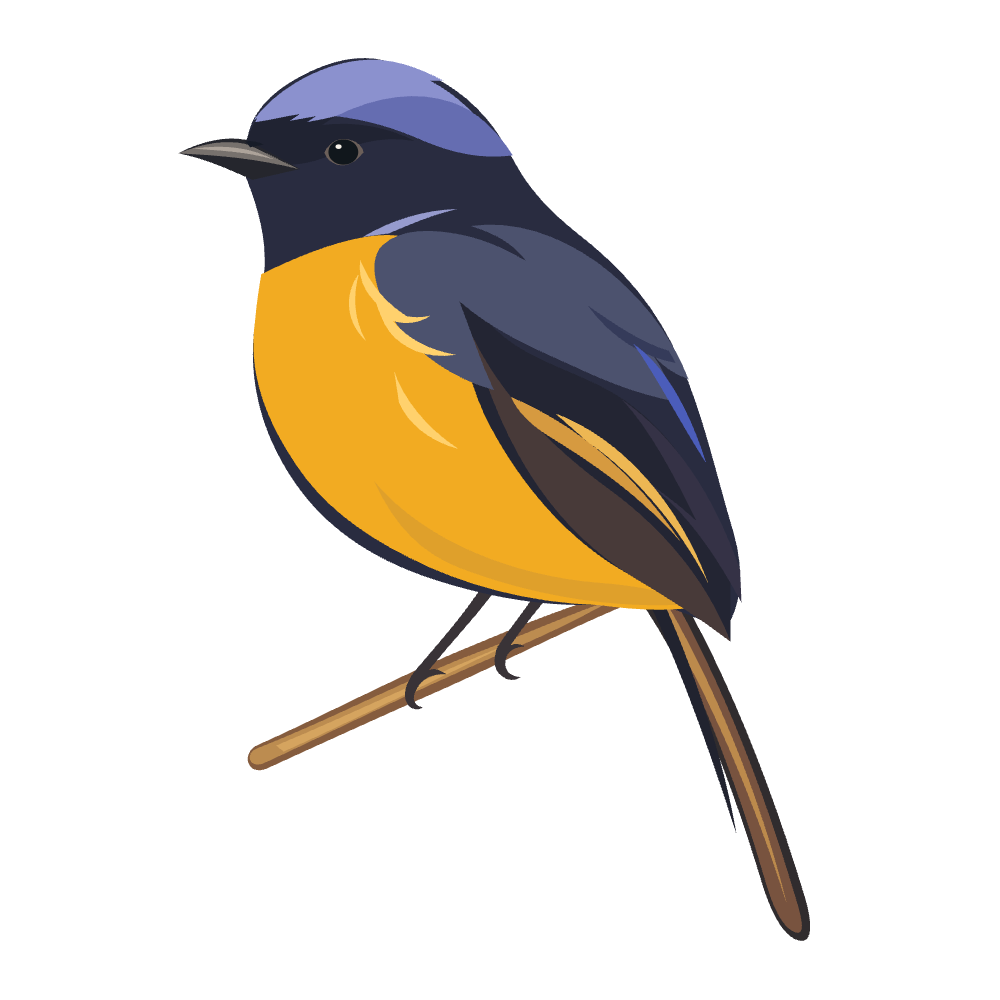
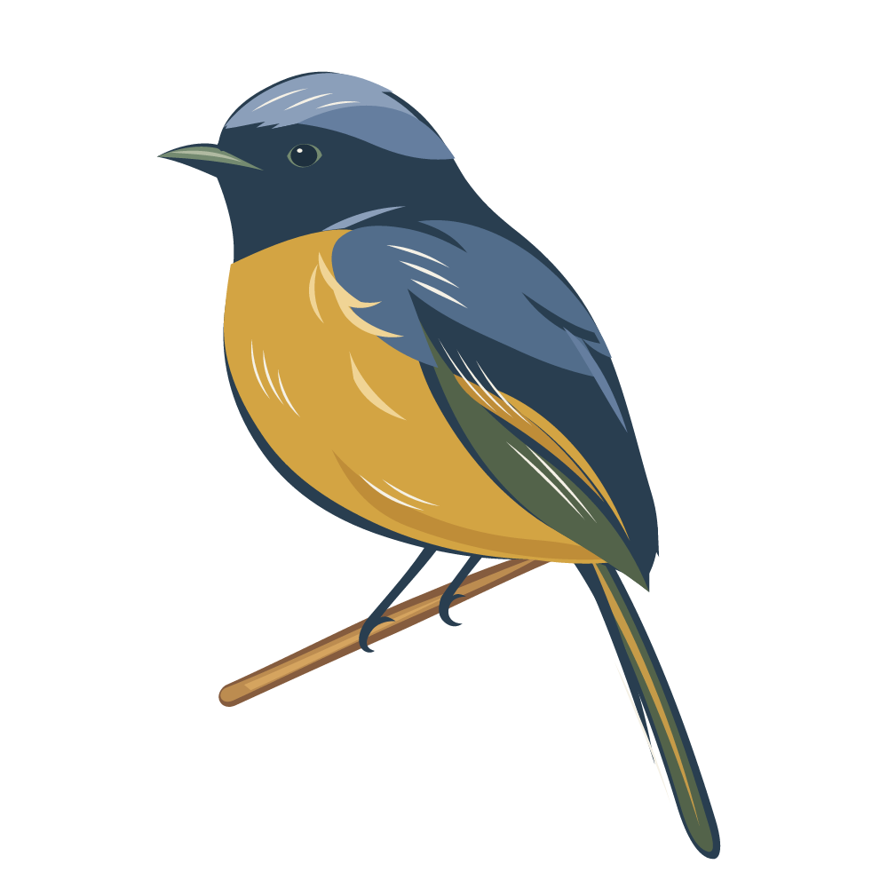

# Brand assets

For a Niltavi site footer or GitHub README, reuse the transparent muted wordmarks. Use the light and dark SVGs as a pair, with their original colors and aspect ratio. For an app with a theme switch, use the app's active theme to pick the asset. On GitHub, use a picture with a dark color-scheme source and a light fallback.

## Wordmarks

| Format | Primary · Light | Primary · Dark | Muted · Light | Muted · Dark |
| --- | --- | --- | --- | --- |
| Preview |  |  |  |  |
| SVG | [SVG](svg/niltavi-light.svg) | [SVG](svg/niltavi-dark.svg) | [SVG](svg/niltavi-muted-light.svg) | [SVG](svg/niltavi-muted-dark.svg) |
| PNG with background | [PNG](png/solid/niltavi-light-1000.png) | [PNG](png/solid/niltavi-dark-1000.png) | [PNG](png/solid/niltavi-muted-light-1000.png) | [PNG](png/solid/niltavi-muted-dark-1000.png) |
| Transparent PNG | [PNG](png/transparent/niltavi-light-1000-transparent.png) | [PNG](png/transparent/niltavi-dark-1000-transparent.png) | [PNG](png/transparent/niltavi-muted-light-1000-transparent.png) | [PNG](png/transparent/niltavi-muted-dark-1000-transparent.png) |

## Birds

| Format | Paper-cut | Woodcut |
| --- | --- | --- |
| Preview |  |  |
| SVG | [SVG](svg/niltavi-bird.svg) | [SVG](svg/niltavi-bird-woodcut.svg) |
| White-background PNG | [PNG](png/solid/niltavi-bird-white-1000.png) | [PNG](png/solid/niltavi-bird-woodcut-white-1000.png) |
| Transparent PNG | [PNG](png/transparent/niltavi-bird-transparent-1000.png) | [PNG](png/transparent/niltavi-bird-woodcut-transparent-1000.png) |

Wordmarks use DM Sans Medium, outlined in SVG. [Font license](FONT-LICENSE.txt).

All PNGs are **1000 × 1000**.
