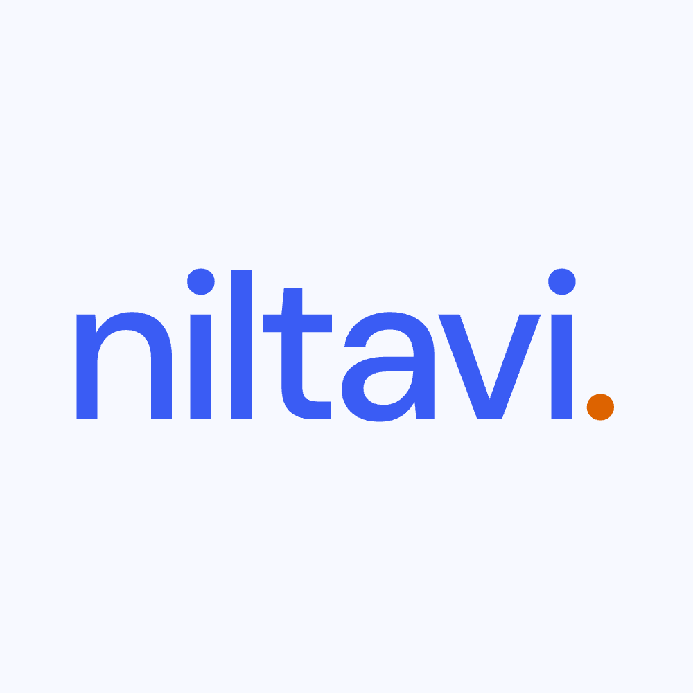
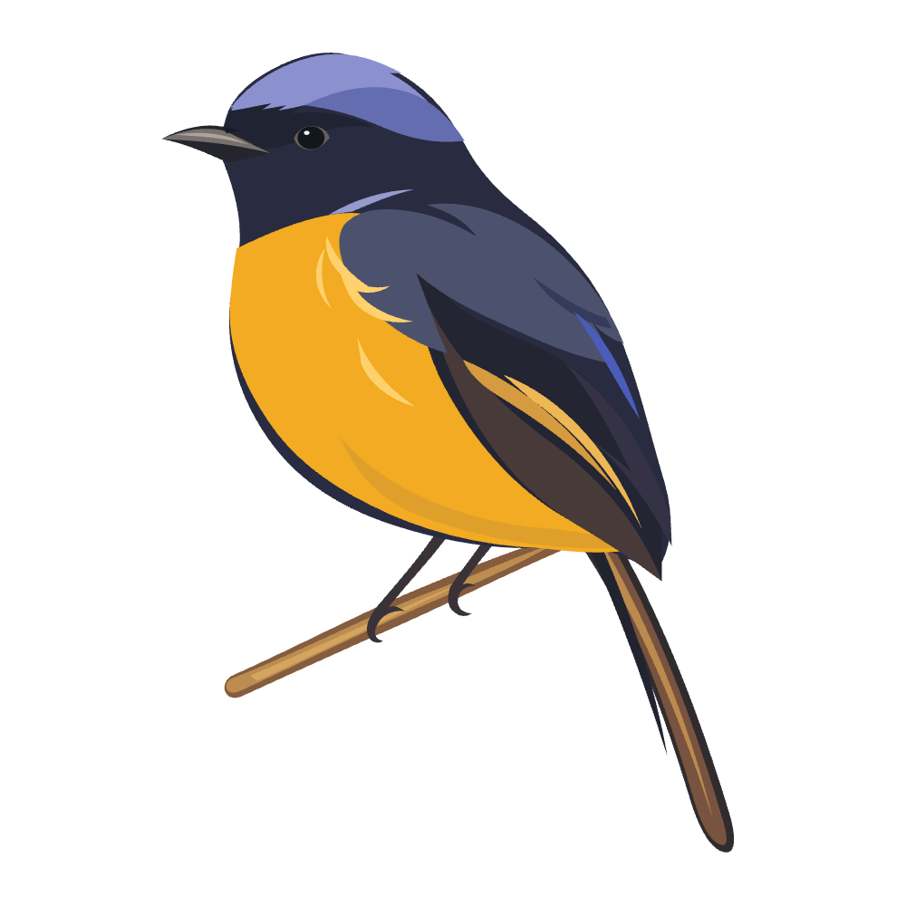
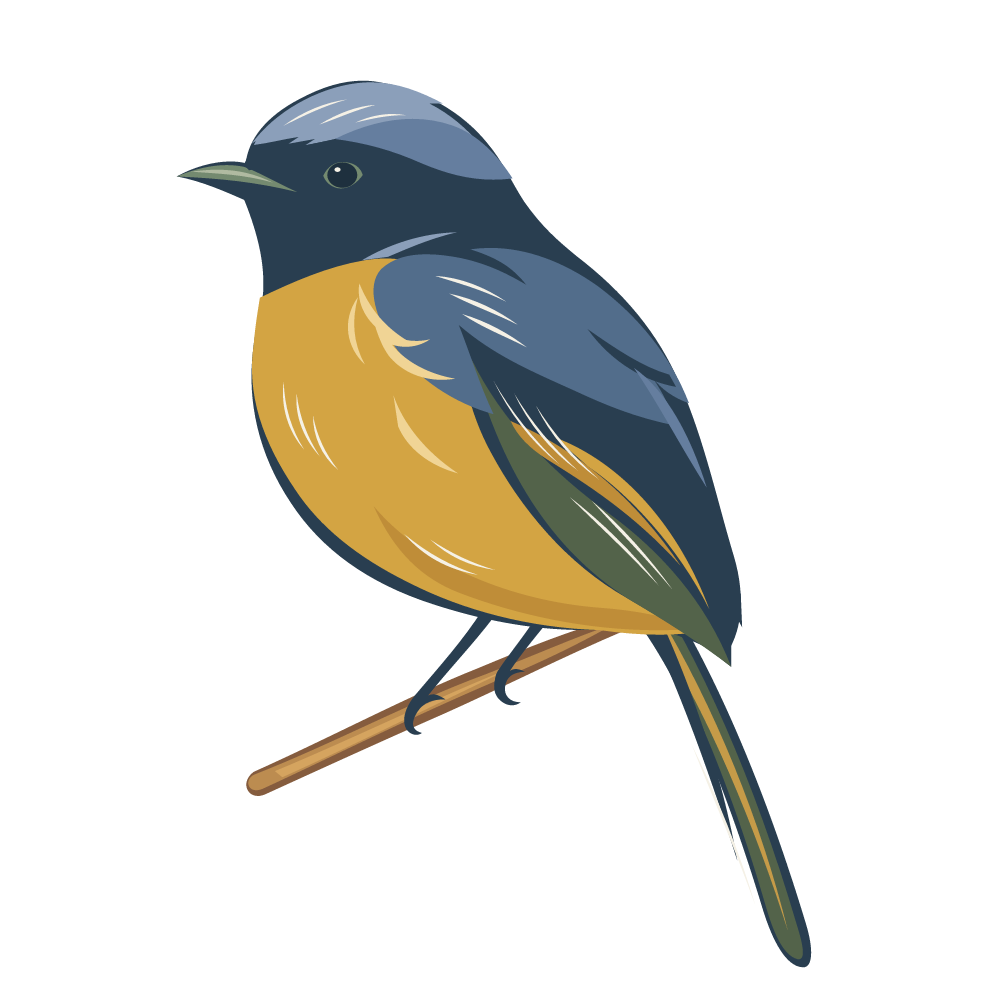

# niltavi logo

Two approved text-only identities, using the niltavi-ui palette, and bird illustrations in paper-cut and woodcut styles.

- **A — Primary:** cobalt lettering with a rufous-orange dot. The default for prominent brand placements.
- **B — Muted:** neutral lettering, cobalt dots above the two i characters, and a rufous-orange period. Use in quieter contexts where a brightly colored wordmark would be too prominent.

## Assets

| Format | A light | A dark | B light | B dark |
| --- | --- | --- | --- | --- |
| Preview |  |  |  |  |
| SVG | [SVG](svg/niltavi-light.svg) | [SVG](svg/niltavi-dark.svg) | [SVG](svg/niltavi-muted-light.svg) | [SVG](svg/niltavi-muted-dark.svg) |
| PNG with background | [PNG](png/solid/niltavi-light-1000.png) | [PNG](png/solid/niltavi-dark-1000.png) | [PNG](png/solid/niltavi-muted-light-1000.png) | [PNG](png/solid/niltavi-muted-dark-1000.png) |
| Transparent PNG | [PNG](png/transparent/niltavi-light-1000-transparent.png) | [PNG](png/transparent/niltavi-dark-1000-transparent.png) | [PNG](png/transparent/niltavi-muted-light-1000-transparent.png) | [PNG](png/transparent/niltavi-muted-dark-1000-transparent.png) |

All wordmark PNGs are **1000 x 1000**, with identical scale and centered placement. Wordmark SVGs contain outlined paths and need no installed fonts or external resources. Light and dark refer to the intended background theme.

## Bird illustration

### Paper-cut

| SVG | White-background PNG | Transparent PNG |
| --- | --- | --- |
| [SVG](svg/niltavi-bird.svg) | [PNG](png/solid/niltavi-bird-white-1000.png) | [PNG](png/transparent/niltavi-bird-transparent-1000.png) |

Both bird PNGs are **1000 x 1000**. The SVG has a transparent background and a portrait viewBox.

### Woodcut

| SVG | White-background PNG | Transparent PNG |
| --- | --- | --- |
| [SVG](svg/niltavi-bird-woodcut.svg) | [PNG](png/solid/niltavi-bird-woodcut-white-1000.png) | [PNG](png/transparent/niltavi-bird-woodcut-transparent-1000.png) |

Extracted from the homepage's [subject artwork](https://github.com/niltavi/niltavi-website/blob/4dc2fc5daab8968d6d5248abbe2c405f030a06aa/src/features/forest/artwork/subject.svg). The standalone SVG preserves the bird's colors, feather incisions, and `0 0 1071 1468` viewBox, with the scene positioning and animation wrappers removed. The pale incisions remain filled in both exports.

Both PNGs are **1000 x 1000**, with the portrait artwork centered and its aspect ratio preserved. The SVG and transparent PNG have no background; the solid PNG uses white.

## Wordmark colors

| Theme | A lettering / B accents | B lettering | Period | Solid background |
| --- | --- | --- | --- | --- |
| Light | `niltava-600` / `#3A5CF4` | `throat-950` / `#1B2235` | `rufous-500` / `#DD6300` | `throat-50` / `#F7F9FF` |
| Dark | `niltava-400` / `#79A4FF` | `throat-50` / `#F7F9FF` | `rufous-300` / `#FFAD5A` | `throat-975` / `#0B1224` |

Typography: DM Sans Medium, originally set at 30px with -1.4px letter spacing. The original typeface license is included in [FONT-LICENSE.txt](FONT-LICENSE.txt).
